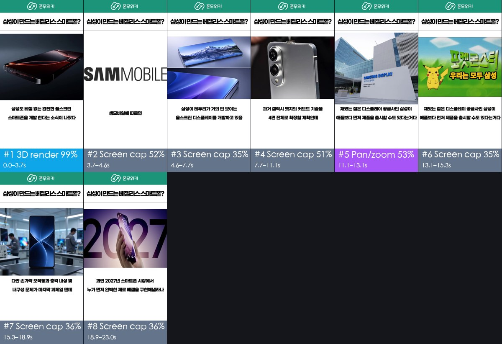

# How this video was made: ref.mp4

**How it was made**: Mixed production: screen recording / screenshot 75% + 3D render 16% + still image + pan/zoom 9%

- 0:23 · vertical 9:16 · 8 shots, 2.9s each on average
- Confidence 50%, based on: tool measurements
- ⚠️ **Nobody has looked at the picture yet**: live action / AI / 3D / code render come from pixel statistics only and are often wrong across the board after platform transcoding. Turn on a VLM or have an agent review the shots (`rea-video review`) before remaking from this report
- ⚠️ 12 points are uncertain, see “Open questions”



# Part one · Breakdown: how this video is built

## At a glance: picture, packaging, sound

Any short video splits into three layers: the picture, what is laid on top of it (subtitles, styled text, stickers), and the sound. Remake it one layer at a time.

| Layer | In this video | How to make it | Detail |
|---|---|---|---|
| **Picture** (base) | screen recording / screenshot 6 shots, 3D render 1 shot, still image + pan/zoom 1 shot | AI in 1 generation; screen recording / motion graphics in code; a single image held or moved | “Remake it yourself” |
| **Packaging** (on top) | subtitle, text, title, layout template, styled text | add in the editor: subtitles, styled text and stickers by the timeline | “Packaging layer” |
| **Sound** | voice, 3 distinct effects (6 hits) | effects: add from a library at the listed times | “Sound” |

## Content and structure

- The whole video's content was not analysed this time (needs AI image reading); subtitle text is under “Packaging layer”

- No narrative line this time (what each shot is doing in the story needs AI image reading); the “Picture” column of the shot list is a start

## Shot list

| # | Frame | Time | Picture | Camera | Made with |
|---|---|---|---|---|---|
| 1 |  | 0:00.0 · 3.7s | — | static | 3D render |
| 2 |  | 0:03.7 · 0.9s | — | static | screen recording / screenshot |
| 3 |  | 0:04.6 · 3.1s | — | static | screen recording / screenshot |
| 4 |  | 0:07.7 · 3.4s | — | static | screen recording / screenshot |
| 5 |  | 0:11.1 · 2.0s | — | static | still image + pan/zoom |
| 6 |  | 0:13.1 · 2.2s | — | static | screen recording / screenshot |
| 7 |  | 0:15.3 · 3.6s | — | static | screen recording / screenshot |
| 8 |  | 0:18.9 · 4.1s | — | static | screen recording / screenshot |

## Cast, scenes and props

- No cast extracted this time (needs AI image reading)

## Camera and lighting

- Framing: shot size medium shot 100%; subject is the in-focus region (no face; shot size is an estimate)
- Camera: fixed camera (tripod / mount / on the desk) 100%
- Lighting: soft frontal light (flat light). Key light frontal (from the camera side; both sides of the subject about equally bright), at subject height; lighting ratio about 1.0:1 (0.0 stops); soft light (almost no lit / shadow edge); colour temperature cool (daylight / cool-white LED); background clearly blurred (shallow depth of field / portrait mode)
- (not live footage: the above describes the light in the picture, for generation prompts, not a shooting plan)
- Grade: natural (close to the original colours); normal saturation, high contrast, normal blacks, overall cool

<details class="ref"><summary>Per-item measurements and image readings (5)</summary>

| Aspect | Item | Verdict | Sources |
|---|---|---|---|
| Framing | shot size | medium shot | measured |
| Camera | camera support | fixed camera (tripod / mount / on the desk) | measured |
| Lighting | soft / hard | soft light (almost no lit / shadow edge) | measured |
| Lighting | colour temperature | cool (daylight / cool-white LED) | measured |
| Grade | colour grade | natural (close to the original colours) | measured |

- Note: lighting ratio, soft / hard, colour temperature and shot size are measured on the subject's pixels (the face when there is one, otherwise the in-focus region, which is an estimate); platform transcodes crush the shadows, so hardness and fill read conservative; camera angle, light source, catchlight and rim light follow the image readers. Where measurement and readers disagree, both are listed.

</details>

## Packaging layer (subtitles / styled text / stickers / sound-effect hits)

- 13 subtitle lines (bottom, up to 1 rows): black text, line height 2.7%; entrance: hard in×4, scale pop×1
- styled text ×2 (tilted, blue fill, pop-in entrance): "삼성디스플레이", "기O경퍼스SDR"
- title ×2: "폰무위키", "삼성이만드는베젤리스스마르폰"
- text label ×2: "SAMSUNG DISPLA", "GHEUNGCAMPUS S"
- SFX hits on: cut ×2, subtitle in ×2, title in ×1, text label in ×1
- Placed by spoken line ×2 (with new wording they follow the line, not the old second): styled text "삼성디스플레이" → 0.0s into "재있는 점은 디스플레이 공급사인 ", on "디스플레이", styled text "기O경퍼스SDR" → 0.0s into "재있는 점은 디스플레이 공급사인 "
- 2 persistent layers (unchanged across cuts: lay each on once for its span, not per shot): title "폰무위키" 0.0–23.0s, title "삼성이만드는베젤리스스마르폰" 0.0–23.0s

<details class="ref"><summary>text timeline (19 rows)</summary>

| Time | Kind | Text | Style | In / out | SFX |
|---|---|---|---|---|---|
| 0.00–23.00s | title | 폰무위키 | white text, keywords highlighted in cyan, line height 3.6% (about 92px) | — | ding |
| 0.00–23.00s | title | 삼성이만드는베젤리스스마르폰? | black text, line height 3.8% (about 96px) | — | — |
| 0.00–3.70s | subtitle | 삼성도 베젤 없는 완전한 풀스크린 | black text, line height 2.9% (about 74px) | hard out | — |
| 0.00–3.10s | subtitle | 스마트폰을 개발 한다는 소식이 나왔다 | black text, line height 2.7% (about 70px) | hard out | — |
| 3.50–4.50s | subtitle | 샘모바일에 따르면 | black text, line height 2.8% (about 72px) | — | — |
| 4.50–7.10s | subtitle | 삼성이 테두리가 거의 안 보이는 | black text, line height 2.7% (about 70px) | hard out | — |
| 4.50–7.10s | subtitle | 올스크린 디스플레이를 개발하고 있음 | black text, line height 2.7% (about 70px) | pop | — |
| 7.50–11.00s | subtitle | 과거 갤럭시 엣지의 커브드 기술을 | black text, line height 2.9% (about 74px) | — | — |
| 7.50–11.00s | subtitle | 4면 전체로 확장할 계획인데 | black text, line height 2.7% (about 70px) | — | — |
| 11.00–13.00s | text label | SAMSUNG DISPLAY | blue text, line height 5.7% (about 146px) | pop | pop |
| 11.00–13.10s | styled text | 삼성디스플레이 | blue text, line height 2.8% (about 72px) | pop / hard out | — |
| 11.00–13.10s | text label | GHEUNGCAMPUS SDR | grey text, line height 2.1% (about 54px) | pop / hard out | — |
| 11.00–13.10s | styled text | 기O경퍼스SDR | grey text, line height 2.0% (about 52px) | pop / hard out | — |
| 11.00–15.30s | subtitle | 재있는 점은 디스플레이 공급사인 삼성이 | black text, line height 2.7% (about 70px) | hard out | — |
| 11.00–15.30s | subtitle | 애플보다 먼저 제품을 출시할 수도 있다는거다 | black text, line height 2.5% (about 64px) | hard out | — |
| 15.30–18.90s | subtitle | 다만 손가락 오작동과 충격 내성 및 | black text, line height 2.7% (about 70px) | hard in / hard out | pop |
| 15.30–18.90s | subtitle | 내구성 문제가 마지막 과제일 텐데 | black text, line height 2.9% (about 74px) | hard in / hard out | — |
| 18.90–23.00s | subtitle | 과연 2027년 스마트폰 시장에서 | black text, line height 2.7% (about 70px) | hard in | pop |
| 18.90–23.00s | subtitle | 누가 먼저 완벽한 제로 베젤을 구현해낼라나 | black text, line height 2.7% (about 70px) | hard in | — |

</details>

| Time | Layer | Spoken line |
|---|---|---|
| 11.00s | styled text "삼성디스플레이" | 0.0s into "재있는 점은 디스플레이 공급사인 ", on "디스플레이" |
| 11.00s | styled text "기O경퍼스SDR" | 0.0s into "재있는 점은 디스플레이 공급사인 " |

- Remake: import `packaging/subtitles.srt` into your editor and put in your own words; the styled version is `packaging/overlays.ass`

## Sound

**Voice**

- male-leaning
- Source: to confirm
- Remake: capsule-cinema DoubaoTTSTool / UniversalTTSTool (or a MiniMax cloned voice); use duration-controlled TTS when it must fit the original time window; follow each line's delivery in the script, add tone tags only on the lines where the emotion turns, and write lines the way they are spoken (pauses, fillers), not as written copy

**Sound effects** (6 hits, 3 distinct sounds)

| Sound | Listen | Type | Times used | At | On screen |
|---|---|---|---|---|---|
| F1 | [listen](sfx/sfx_01.wav) | ding | 1 | 0.1s | title "폰무위키" appears |
| F2 | [listen](sfx/sfx_02.wav) | ding | 4 | 3.8s, 7.8s, 11.2s, 15.4s | cut; text label "SAMSUNG DISPLAY" appears; subtitle "다만 손가락 오작동과 충격 내" appears |
| F3 | [listen](sfx/sfx_03.wav) | pop | 1 | 19.0s | subtitle "과연 2027년 스마트폰 시장" appears |

- Remake: play each sound, find a similar one in your editor's library and place it at the times under “At”

**Listen to the tracks**

- voice: [stems/vocals.wav](stems/vocals.wav)

<details class="ref"><summary>Sound measurements and evidence</summary>


- Loudness -21.8 dBFS, peak -3.4 dBFS
- each clip carries its own sound (background jumps 38.6dB at cuts vs 6.4dB within shots)
- Voice on 58% of the duration, pitch about 134.5Hz
- Voice source: to confirm (TTS voice-over 43%, human recording 43%, native dialogue from the AI video model 14%)

</details>

## Open questions

- The VLM did not run (No VLM; live action / AI / 3D are told apart from pixel statistics only, so confidence is limited. An agent that can see images: run rea-video review, look at each shot and merge with apply-review; otherwise configure a VLM: set GEMINI_API_KEY to use Gemini directly; for another multimodal model (GPT-4o, Doubao, Qwen-VL...), set REA_VLM_BASE_URL, REA_VLM_API_KEY and REA_VLM_MODEL. Then rerun with --vlm): live action / AI / 3D is decided by signal forensics alone; configure a multimodal model and rerun with --vlm, or have an agent review the frames
- Shot #2 (3.7–4.6s): screen recording / screenshot at only 52% confidence, runner-up code / template render
- Shot #3 (4.6–7.7s): screen recording / screenshot at only 35% confidence, runner-up static hold
- Shot #3 (4.6–7.7s): photo / image: real material or generated, to confirm
- Shot #4 (7.7–11.1s): screen recording / screenshot at only 51% confidence, runner-up code / template render
- Shot #5 (11.1–13.1s): still image + pan/zoom at only 53% confidence, runner-up code / template render
- Shot #5 (11.1–13.1s): photo / image: real material or generated, to confirm
- Shot #6 (13.1–15.3s): screen recording / screenshot at only 35% confidence, runner-up static hold
- Shot #7 (15.3–18.9s): screen recording / screenshot at only 36% confidence, runner-up code / template render
- Shot #8 (18.9–23.0s): screen recording / screenshot at only 36% confidence, runner-up code / template render
- No AI listened to the soundtrack: real voice versus TTS is inferred from the waveform; the effects were found on the separated effects track and their types are estimated from the sound. Play the stems and each effect under “Sound” to check
- voice source to confirm: most likely TTS voice-over (43%); how to check is under “Sound”

# Part two · Remake plan

Planned for **MiniMax H3 / H3 Max**: ≤15 s per call, several shots per call, takes reference video (3 clips, ≤15 s in all), ≤9 reference images, first / last frame, native sound. Name another model and the split, lengths and prompts are redone for it.

## Remake it yourself: do it in this order

Copy the method and the rhythm, not the pictures: keep what each part does and fill it with your own content and material.

This is a screen tutorial / software demo. Do the steps in this order; the detail for each is in the matching subsection below.

1. **Write the content**: one picture of your own for each of the 8 shots in the shot list
2. **Collect material**: the real material in the picture (UI screenshot) needs the original files, listed under “What to prepare”
3. **Voice**: where the original voice comes from is to confirm; record it yourself or use TTS
4. **Edit**: follow the order and lengths in the shot list; the original has 8 shots at 2.9s each
5. **Subtitles and styled text**: import `packaging/subtitles.srt` and replace the words; timing and style under “Packaging layer”
6. **Put it together and compare**: hand the shots you made to the agent; it places them on the original timeline, keeps the original where yours are missing, and renders a side-by-side comparison with the original

### What to prepare

- Real files shown in the picture (screenshots, photos, recordings; get the originals):
  - **UI screenshot** (whole frame): shots #2–#4, #6–#8, 17.3s in all

### AI generation

**1 generation, 4 s in total**

> ⚠️ G1: the prompts are the tool's drafts, already in MiniMax H3 / H3 Max's layout. Check them against the model's conventions and good prompts for similar shots, then put the finals into `remake/prompts.json`; `rea-video plan` then checks the format.

| Part | Shots | Time | Length | Prepare |
|---|---|---|---|---|
| G1 | #1 | 0.0–3.7s | 3.7s | reference images |

<details class="ref"><summary>Why it is split this way</summary>

- Grouping: consecutive shots share a call where they fit, ≤10s per call, ≤4 shots; a long stretch is cut at a scene change first
- Inputs: the model also takes reference video, but its default plan is used here: one source frame per shot (subtitles erased) fixes composition, swapped-in things get their own images
- Audio: the model can generate action sound effects and ambience along with the picture; the voice was recorded by a person: record it separately and mix it in rather than having the video model speak, so copy and timing stay editable
- Packaging: the title, subtitle on the generated shots is post-production packaging: keep it out of the prompts (erased from source references) and lay it back on from the packaging timeline after generation

</details>

<details><summary>G1 · shots #1 · 3.7s</summary>

- reference images: source frames of shots #1 (subtitles erased)

Draft prompt (in MiniMax H3 / H3 Max's layout; check it and put the final into remake/prompts.json before generating):

```text
integrated_multimodal_description: Generate the shots below in order in one go, hard cuts between them; each shot takes composition, size and camera from its source frame image. Vertical 9:16; soft frontal light, cool tones, background clearly blurred.
[Shot 1] (no description: write one in the image review) (composition: <Picture 1>). SFX: ding
overall_soundscape: Distinct action sounds: ding.
non_diegetic_music: N/A
```

</details>

<details><summary>Prompt guides for MiniMax H3 / H3 Max</summary>

- https://huggingface.co/MiniMaxAI/MiniMax-H3/raw/main/docs/VIDEO_PROMPT_WRITING_GUIDE_base_en.md
- https://huggingface.co/MiniMaxAI/MiniMax-H3/raw/main/docs/VIDEO_PROMPT_WRITING_GUIDE_ref_en.md
- https://platform.minimax.io/docs/api-reference/video-generation-v2-create
- https://docs.comfy.org/tutorials/video/minimax/minimax-h3-prompt-guide.md

</details>

### Code build

Rebuild it as one project in an HTML video framework (such as HyperFrames or Remotion): cuts, transitions and each shot's key frames from "Rhythm and key frames", layout, colours and elements from the scenes below. Text and UI are 100% controllable, changing copy is a data change, and an AI coding assistant can write the project.

`rea-video code-remake <breakdown folder>` only makes a quick draft: it renders `code/remake.mp4` from each scene's sampled points / cut-out, motion and background glow and scores it. Particles, point clouds and data visualisations on a dark ground come close; an illustrated character's acting and morph transitions do not.

- Part 1: shots #2–#4 (3.7–11.1s); #2–#4 use real screen recordings
- Part 2: shots #6–#8 (13.1–23.0s); #6–#8 use real screen recordings

Remake assets (all in the report folder; hand them over together with the data below to whoever writes the code, or to an LLM):
- `shots/shot_XXX_first.jpg` / `_last.jpg`: first / last frame of each shot at full size, for layout, type size and margins
- `shots/shot_XXX_strip.jpg`: key frames about every 0.5 s, to follow the animation
- `shots/shot_XXX_elements.jpg` and `_el_NN.jpg` / `_st_NN.jpg` / `_ly_NN.jpg`: full-size crop of every element once settled, numbered as in the motion timeline; redraw shapes from them, cut out icons, logos and illustrations that cannot be redrawn
- `packaging/overlays.ass`, `packaging/timeline.json`: timing, position and colour of the text

How to build the pictures (by the measured picture type):
- kinetic type: Word-by-word spring() entrances (offset + scale + opacity), highlight boxes on key words; match font, size and leading from the frame

| Shot | Time | Build | Picture | Camera | Colours | On-screen text |
|---|---|---|---|---|---|---|
| #2 | 3.7–4.6s | kinetic type | (to fill from the images: what the elements form and how they move) | static | ground #fcfcfc · #01857b #242627 #d0d4d5 #6f7071 · drawn #2d2d2d #118578 #020202 #8c8c8c | SAMMOBILE / 폰무위키 / 삼성이만드는베첼리스스마르폰? / 삼성이만드는베젤리스스마르폰? |
| #3 | 4.6–7.7s | kinetic type | (to fill from the images: what the elements form and how they move) | static | ground #fafbfc · #a3b7db #4a5577 #03867c #7581a4 · drawn #2f3a6e #5c6bb3 #0b0d15 #118578 | 폰무위키 / 삼성이만드는베젤리스스마르폰? |
| #4 | 7.7–11.1s | kinetic type | (to fill from the images: what the elements form and how they move) | static | ground #fcfcfc · #0c0d0f #777779 #5b5c60 #01857b · drawn #fbfcfc #050506 #161314 | 폰무위키 / 삼성이만드는베젤리스스마르폰? / 삼성이만드는베젤리스스마크폰? |
| #6 | 13.1–15.3s | kinetic type | (to fill from the images: what the elements form and how they move) | static | ground #fafcfc · #4e8f1d #71acbf #2e847a #b5cbc4 · drawn #4a7b1e #0d0e09 #118578 #6b9bb0 | 우리는모두삼성 / 폰무위키 / 삼성이만드는베젤리스스마르폰? |
| #7 | 15.3–18.9s | kinetic type | (to fill from the images: what the elements form and how they move) | static | ground #f7fbfc · #6b839a #0a1529 #283550 #4d5e70 · drawn #fdfdfd #0d182a #546475 #108278 | 폰무위키 / 삼성이만드는베젤리스스마트폰? |
| #8 | 18.9–23.0s | kinetic type | (to fill from the images: what the elements form and how they move) | static | ground #fcfcfc · #716179 #9d919e #4a3c59 #c8bdc0 · drawn #05020e #35234b #725f73 #118578 | 폰무위키 / 삼성이만드는베젤리스스마르폰? |

Per-shot motion timeline (measured: positions in % of frame width / height, colours sampled once the element settles; read together with the key-frame strip)

<details class="ref"><summary>Motion #2 3.7–4.6s · 0 events</summary>


- Ground #fcfcfc; other main colours #01857b #242627 #d0d4d5 #6f7071; drawn layer #2d2d2d #118578 #020202 #8c8c8c
Element crops (numbers match the motion list below; L = the continuously moving layer mid-shot and at the end, S = elements that never move), full-size files in `shots/`:


- S1. never moves: shape / text block · x 0%–100%, y 0%–9% · #108578 · text “폰무위키” · [crop](shots/shot_002_st_01.jpg)
- S2. never moves: horizontal line · x 3%–97%, y 12%–17% · #000000 · text “삼성이만드는베첼리스스마르폰? / 삼성이만드는베젤리스스마르폰?” · [crop](shots/shot_002_st_02.jpg)
- S3. never moves: horizontal line · x 0%–100%, y 20%–21% · #dedede · [crop](shots/shot_002_st_03.jpg)
- S4. never moves: shape / text block · x 0%–44%, y 45%–55% · #292929 · [crop](shots/shot_002_st_04.jpg)
- S5. never moves: shape / text block · x 44%–59%, y 45%–55% · #292929 · text “SAMMOBILE” · [crop](shots/shot_002_st_05.jpg)
- S6. never moves: shape / text block · x 71%–80%, y 45%–55% · #292929 · [crop](shots/shot_002_st_06.jpg)
- S7. never moves: shape / text block · x 84%–100%, y 45%–55% · #292929 · [crop](shots/shot_002_st_07.jpg)
- S8. never moves: shape / text block · x 29%–70%, y 74%–78% · #000000 · text “샘모바일에 따르면 / 삼성이 테두리가 거의 안 보이는 / 올스크린 디스플레이를 개발하고 있음” · [crop](shots/shot_002_st_08.jpg)

</details>

<details class="ref"><summary>Motion #3 4.6–7.7s · 0 events</summary>


- Ground #fafbfc; other main colours #a3b7db #4a5577 #03867c #7581a4; drawn layer #2f3a6e #5c6bb3 #0b0d15 #118578
- No element motion measured (still picture or only slight changes)

</details>

<details class="ref"><summary>Motion #4 7.7–11.1s · 1 events</summary>


- Ground #fcfcfc; other main colours #0c0d0f #777779 #5b5c60 #01857b; drawn layer #fbfcfc #050506 #161314
Element crops (numbers match the motion list below; L = the continuously moving layer mid-shot and at the end, S = elements that never move), full-size files in `shots/`:


1. 8.00–8.07s · bottom (x 20%–78%, y 78%–81%) · changes, instant · #939393 · text “4면 전체로 확장할 계획인데 / 애플보다 먼저 제품을 출시할 수도 있다는거다” · [crop](shots/shot_004_el_01.jpg)

</details>

<details class="ref"><summary>Motion #6 13.1–15.3s · 0 events</summary>


- Ground #fafcfc; other main colours #4e8f1d #71acbf #2e847a #b5cbc4; drawn layer #4a7b1e #0d0e09 #118578 #6b9bb0
Element crops (numbers match the motion list below; L = the continuously moving layer mid-shot and at the end, S = elements that never move), full-size files in `shots/`:


- S1. never moves: shape / text block · x 0%–100%, y 0%–9% · #108578 · text “폰무위키” · [crop](shots/shot_006_st_01.jpg)
- S2. never moves: horizontal line · x 3%–97%, y 12%–17% · #000000 · text “삼성이만드는베젤리스스마르폰?” · [crop](shots/shot_006_st_02.jpg)
- S3. never moves: shape / text block · x 0%–100%, y 24%–66% · #448c16 · text “포랫몬스터 / 우리는모두삼성 / 포랫몬스” · [crop](shots/shot_006_st_03.jpg)
- S4. never moves: horizontal line · x 6%–93%, y 72%–75% · #010101 · text “재있는 점은 디스플레이 공급사인 삼성이” · [crop](shots/shot_006_st_04.jpg)
- S5. never moves: horizontal line · x 1%–99%, y 78%–81% · #000000 · text “애플보다 먼저 제품을 출시할 수도 있다는거다” · [crop](shots/shot_006_st_05.jpg)

</details>

<details class="ref"><summary>Motion #7 15.3–18.9s · 0 events</summary>


- Ground #f7fbfc; other main colours #6b839a #0a1529 #283550 #4d5e70; drawn layer #fdfdfd #0d182a #546475 #108278
- No element motion measured (still picture or only slight changes)

</details>

<details class="ref"><summary>Motion #8 18.9–23.0s · 0 events</summary>


- Ground #fcfcfc; other main colours #716179 #9d919e #4a3c59 #c8bdc0; drawn layer #05020e #35234b #725f73 #118578
Element crops (numbers match the motion list below; L = the continuously moving layer mid-shot and at the end, S = elements that never move), full-size files in `shots/`:


- S1. never moves: shape / text block · x 0%–100%, y 0%–9% · #108578 · text “폰무위키” · [crop](shots/shot_008_st_01.jpg)
- S2. never moves: horizontal line · x 3%–97%, y 12%–17% · #000000 · text “삼성이만드는베젤리스스마르폰?” · [crop](shots/shot_008_st_02.jpg)
- S3. never moves: horizontal line · x 0%–100%, y 20%–21% · #dedede · [crop](shots/shot_008_st_03.jpg)
- S4. never moves: shape / text block · x 0%–100%, y 24%–65% · #23133d · [crop](shots/shot_008_st_04.jpg)
- S5. never moves: horizontal line · x 14%–84%, y 72%–75% · #020202 · text “과연 2027년 스마트폰 시장에서” · [crop](shots/shot_008_st_05.jpg)
- S6. never moves: horizontal line · x 3%–97%, y 78%–81% · #000000 · text “누가 먼저 완벽한 제로 베젤을 구현해낼라나” · [crop](shots/shot_008_st_06.jpg)

</details>

### Local rebuild

- #5 still image + pan/zoom 2.0s: one image + the measured zoom / pan parameters, rendered straight from ffmpeg

### Edit

- Cut in the order and lengths of the shot list
- Rhythm: 18.2 cuts per minute, 2.88s average shot; no live-action shots; transitions cut×7

## Appendix

### Shot by shot

Each shot has two parts: what is visible on screen, and how the tools infer it was made (with the basis); remake prompts last. Folded by default.

<details class="ref"><summary>#1 00:00.000–00:03.700 · 3D render + code / editor overlays (subtitles, text labels, title, layout template)</summary>


**Visible on screen** (check against the frames)
- Camera / lighting: medium shot; fixed camera (tripod / mount / on the desk); soft frontal light (flat light); key light frontal (from the camera side; both sides of the subject about equally bright); lighting ratio about 1.0:1 (0.0 stops); soft light (almost no lit / shadow edge)
- Text track (subtitle/bottom): 삼성도 베젤 없는 완전한 풀스크린 / 스마트폰을 개발 한다는 소식이 나왔다 / 샘모바일에 따르면
- Text track (text/middle): SAMMOBILE
- Text track (title/top): 폰무위키
- Text track (title/top): 삼성이만드는베젤리스스마크폰? / 삼성이만드는베첼리스스마르폰?
- [AI assistant shot look] The key frames read this stretch as 3D render

**How it was made, as inferred by the tools** (inferred, not seen)
- Inference: 3D render 98%, code / template render 1%, 2D animation 0% (fused_agent)
- Material: rendered by the creator
- Basis (tool measurements, not necessarily visible to the eye):
  - Rendered texture: 60% flat colour blocks, 95% of pixels use only 30 colours, 50% axis-aligned edges
  - Duplicate frames follow a 24→30 pattern (19%, period 5): a 24/25fps source transcoded up, typical of AI-generated video, 3D / animation renders or cinema footage

- Remake: 3D render: a video model gives an approximation (see the generation units); for precise multiple angles, model in 3D and render in Blender

</details>

<details class="ref"><summary>#2 00:03.700–00:04.600 · screen recording / screenshot + code / editor overlays (layout template); brings in real material (UI screenshot)</summary>


**Visible on screen** (check against the frames)
- Text track (text in the picture/bottom): 샘모바일에 따르면 / 삼성이 테두리가 거의 안 보이는 / 올스크린 디스플레이를 개발하고 있음
- Text track (text in the picture/middle): SAMMOBILE
- Text track (text in the picture/top): 폰무위키
- Text track (text in the picture/top): 삼성이만드는베첼리스스마르폰? / 삼성이만드는베젤리스스마르폰?
- [AI assistant shot look] The key frames read this stretch as still image + pan/zoom

**How it was made, as inferred by the tools** (inferred, not seen)
- Inference: screen recording / screenshot 52%, code / template render 43%, static hold 1% (fused_agent)
- Material: the user's real material: UI screenshot
- Basis (tool measurements, not necessarily visible to the eye):
  - Picture is almost entirely still: 91% of adjacent frames are pixel-identical, first-to-last frame difference 0.05
  - Rendered texture: 85% flat colour blocks, 95% of pixels use only 3 colours, 61% axis-aligned edges
  - Platform transcode (YouTube) has compressed the sensor noise away: noise cues no longer apply, live action vs AI rests on frame rate and picture content

- Remake: Screen recording / screenshot: rebuild from a real screen recording or web screenshot; real material the user must supply: UI screenshot (whole frame)

</details>

<details class="ref"><summary>#3 00:04.600–00:07.733 · screen recording / screenshot + code / editor overlays (layout template); brings in real material (UI screenshot)</summary>


**Visible on screen** (check against the frames)
- Text track (text in the picture/bottom): 삼성이 테두리가 거의 안 보이는 / 올스크린 디스플레이를 개발하고 있음 / 과거 갤럭시 엣지의 커브드 기술을 / 4면 전체로 확장할 계획인데
- Text track (text in the picture/top): 폰무위키
- Text track (text in the picture/top): 삼성이만드는베젤리스스마르폰?
- [AI assistant shot look] The key frames read this stretch as still image + pan/zoom

**How it was made, as inferred by the tools** (inferred, not seen)
- Inference: screen recording / screenshot 35%, static hold 32%, code / template render 29% (fused_agent)
- Material: the user's real material: UI screenshot; real or not, to confirm: photo / image
- Basis (tool measurements, not necessarily visible to the eye):
  - Picture is almost entirely still: 100% of adjacent frames are pixel-identical, first-to-last frame difference 0.02
  - Rendered texture: 46% flat colour blocks, 95% of pixels use only 160 colours, 44% axis-aligned edges
  - Platform transcode (YouTube) has compressed the sensor noise away: noise cues no longer apply, live action vs AI rests on frame rate and picture content

- Remake: Screen recording / screenshot: rebuild from a real screen recording or web screenshot; real material the user must supply: UI screenshot (whole frame)

</details>

<details class="ref"><summary>#4 00:07.733–00:11.100 · screen recording / screenshot + code / editor overlays (layout template); brings in real material (UI screenshot)</summary>


**Visible on screen** (check against the frames)
- Text track (text in the picture/bottom): 과거 갤럭시 엣지의 커브드 기술을 / 4면 전체로 확장할 계획인데 / 재있는 점은 디스플레이 공급사인 삼성이 / 애플보다 먼저 제품을 출시할 수도 있다는거다
- Text track (text in the picture/middle): SAMSUNG DISPLAY / 삼성디스플레이 / GHEUNGCAMPUS SDR
- Text track (text in the picture/middle): 기O경퍼스SDR
- Text track (text in the picture/top): 폰무위키
- [AI assistant shot look] The key frames read this stretch as still image + pan/zoom

**How it was made, as inferred by the tools** (inferred, not seen)
- Inference: screen recording / screenshot 51%, code / template render 43%, static hold 2% (fused_agent)
- Material: the user's real material: UI screenshot
- Basis (tool measurements, not necessarily visible to the eye):
  - Picture is almost entirely still: 98% of adjacent frames are pixel-identical, first-to-last frame difference 0.18
  - Rendered texture: 57% flat colour blocks, 95% of pixels use only 22 colours, 51% axis-aligned edges
  - Platform transcode (YouTube) has compressed the sensor noise away: noise cues no longer apply, live action vs AI rests on frame rate and picture content

- Remake: Screen recording / screenshot: rebuild from a real screen recording or web screenshot; real material the user must supply: UI screenshot (whole frame)

</details>

<details class="ref"><summary>#5 00:11.100–00:13.100 · still image + pan/zoom (designed / rendered graphic) + code / editor overlays (subtitles, text labels, title, layout template, styled text)</summary>


**Visible on screen** (check against the frames)
- Text track (subtitle/bottom): 재있는 점은 디스플레이 공급사인 삼성이 / 애플보다 먼저 제품을 출시할 수도 있다는거다
- Text track (subtitle/middle): SAMSUNG DISPLAY / 삼성디스플레이 / GHEUNGCAMPUS SDR / 우리는모두삼성
- Text track (text/middle): 기O경퍼스SDR
- Text track (text/middle): 포랫몬스터
- [AI assistant shot look] The key frames read this stretch as still image + pan/zoom

**How it was made, as inferred by the tools** (inferred, not seen)
- Inference: still image + pan/zoom 53%, code / template render 10%, 3D render 7% (fused_agent)
- Still source: graphic
- Material: rendered by the creator; real or not, to confirm: photo / image
- Basis (tool measurements, not necessarily visible to the eye):
  - 96% of adjacent frames are exact duplicates, only local elements move (typical of template / motion-graphics animation, or a hold with local motion)
  - Rendered texture: 50% flat colour blocks, 95% of pixels use only 61 colours, 31% axis-aligned edges
  - 100% of background pixels never change frame to frame while local elements move: 2D compositing / code-driven motion graphics
  - Platform transcode (YouTube) has compressed the sensor noise away: noise cues no longer apply, live action vs AI rests on frame rate and picture content

- Remake: Still-image move: one image + the measured zoom / pan parameters, reproduced exactly with local ffmpeg

</details>

<details class="ref"><summary>#6 00:13.100–00:15.300 · screen recording / screenshot + code / editor overlays (layout template); brings in real material (UI screenshot)</summary>


**Visible on screen** (check against the frames)
- Text track (text in the picture/bottom): 재있는 점은 디스플레이 공급사인 삼성이 / 애플보다 먼저 제품을 출시할 수도 있다는거다
- Text track (text in the picture/middle): 포랫몬스터 / 포랫몬스
- Text track (text in the picture/middle): 우리는모두삼성
- Text track (text in the picture/top): 폰무위키
- [AI assistant shot look] The key frames read this stretch as still image + pan/zoom

**How it was made, as inferred by the tools** (inferred, not seen)
- Inference: screen recording / screenshot 35%, static hold 31%, code / template render 29% (fused_agent)
- Material: the user's real material: UI screenshot
- Basis (tool measurements, not necessarily visible to the eye):
  - Picture is almost entirely still: 100% of adjacent frames are pixel-identical, first-to-last frame difference 0.21
  - Rendered texture: 48% flat colour blocks, 95% of pixels use only 131 colours, 52% axis-aligned edges
  - Platform transcode (YouTube) has compressed the sensor noise away: noise cues no longer apply, live action vs AI rests on frame rate and picture content

- Remake: Screen recording / screenshot: rebuild from a real screen recording or web screenshot; real material the user must supply: UI screenshot (whole frame)

</details>

<details class="ref"><summary>#7 00:15.300–00:18.900 · screen recording / screenshot + code / editor overlays (layout template); brings in real material (UI screenshot)</summary>


**Visible on screen** (check against the frames)
- Text track (text in the picture/bottom): 다만 손가락 오작동과 충격 내성 및 / 내구성 문제가 마지막 과제일 텐데
- Text track (text in the picture/top): 폰무위키
- Text track (text in the picture/top): 삼성이만드는베젤리스스마트폰?
- [AI assistant shot look] The key frames read this stretch as still image + pan/zoom

**How it was made, as inferred by the tools** (inferred, not seen)
- Inference: screen recording / screenshot 36%, code / template render 30%, static hold 30% (fused_agent)
- Material: the user's real material: UI screenshot
- Basis (tool measurements, not necessarily visible to the eye):
  - Picture is almost entirely still: 98% of adjacent frames are pixel-identical, first-to-last frame difference 0.02
  - Rendered texture: 42% flat colour blocks, 95% of pixels use only 103 colours, 43% axis-aligned edges
  - Platform transcode (YouTube) has compressed the sensor noise away: noise cues no longer apply, live action vs AI rests on frame rate and picture content

- Remake: Screen recording / screenshot: rebuild from a real screen recording or web screenshot; real material the user must supply: UI screenshot (whole frame)

</details>

<details class="ref"><summary>#8 00:18.900–00:23.033 · screen recording / screenshot + code / editor overlays (layout template); brings in real material (UI screenshot)</summary>


**Visible on screen** (check against the frames)
- Text track (text in the picture/bottom): 과연 2027년 스마트폰 시장에서 / 누가 먼저 완벽한 제로 베젤을 구현해낼라나
- Text track (text in the picture/top): 폰무위키
- Text track (text in the picture/top): 삼성이만드는베젤리스스마르폰?
- [AI assistant shot look] The key frames read this stretch as still image + pan/zoom

**How it was made, as inferred by the tools** (inferred, not seen)
- Inference: screen recording / screenshot 36%, code / template render 30%, static hold 30% (fused_agent)
- Material: the user's real material: UI screenshot
- Basis (tool measurements, not necessarily visible to the eye):
  - Picture is almost entirely still: 98% of adjacent frames are pixel-identical, first-to-last frame difference 0.01
  - Rendered texture: 49% flat colour blocks, 95% of pixels use only 109 colours, 47% axis-aligned edges
  - Platform transcode (YouTube) has compressed the sensor noise away: noise cues no longer apply, live action vs AI rests on frame rate and picture content

- Remake: Screen recording / screenshot: rebuild from a real screen recording or web screenshot; real material the user must supply: UI screenshot (whole frame)

</details>

### Metadata clues

- Encoder: `Lavf61.1.100`
- platform: YouTube

### Notes

- Deterministic forensics is reliable on motion, whole-frame pan/zoom, rendered texture and 24→30 fps conversion; telling live action from AI from 3D needs image reading (a VLM or an AI assistant's review), and a look at the frames yourself.
- Platform transcoding usually strips metadata; missing metadata proves nothing.
- The full data is in `breakdown.json`; the package for models starts at `VIDEO.md`.

---

Made with [REA-VIDEO](https://github.com/JuneYaooo/rea-video) · https://github.com/JuneYaooo/rea-video
